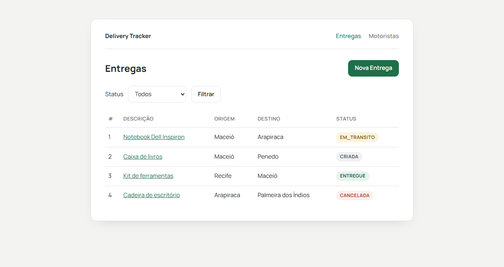

# Delivery Tracker

Sistema web para rastrear o ciclo de vida de entregas e os motoristas que as realizam,
feito com **Node + Express** e **arquitetura em camadas**. As páginas são
**renderizadas no servidor (SSR) com EJS**, e os dados ficam num banco **SQLite**,
acessado pelo **Prisma ORM**.

> **Programação Web II** — IFAL/Maceió · Capítulo 6 · **Atividade 08**.
> Nesta etapa a API JSON dá lugar a uma **interface web**: listagens, formulários e
> ações por botão — sem mudar os services nem os repositories do Cap. 5.



---

## Requisitos

- **Node 20.11+**
- npm

## Como executar

```bash
npm install                  # instala e gera o Prisma Client (postinstall)
cp .env.example .env         # DATABASE_URL="file:./dev.db"
npx prisma migrate dev       # cria o banco e aplica as migrations
npm run dev                  # abra http://localhost:3000 no navegador
```

O servidor respeita a variável `PORT` e mantém `GET /api/health` → `{ "status": "ok" }`
só para checar se ele subiu:

```bash
PORT=8080 npm start     # http://localhost:8080
```

### Banco de dados

O banco é configurado pela variável `DATABASE_URL` (veja `.env.example`). O caminho
`file:./dev.db` é relativo ao `schema.prisma`, então o arquivo fica em `prisma/dev.db` —
fora do git, assim como o `.env`.

| Comando                     | Atalho               | Para quê                                                    |
| --------------------------- | -------------------- | ----------------------------------------------------------- |
| `npx prisma migrate dev`    | `npm run db:migrate` | desenvolvimento: aplica as migrations (e cria novas se o schema mudou) |
| `npx prisma migrate deploy` | `npm run db:deploy`  | CI/produção: só aplica as migrations já versionadas         |
| `npx prisma studio`         | `npm run db:studio`  | abre uma interface web para ver e editar os dados           |
| `npx prisma generate`       | —                    | regera o Prisma Client (já roda sozinho no `npm install`)   |

### Rodando o autograder

Com o servidor no ar, em outro terminal:

```bash
npm run check           # = BASE_URL=http://localhost:3000 node autograder/check.mjs
```

O autograder age como um navegador: confere os status HTTP, o redirect do PRG e procura
trechos no HTML (tabela, formulário, badge de status, histórico). No GitHub Actions o
workflow roda `prisma migrate deploy` antes de subir o servidor.

---

## Estrutura do projeto

```
server.js                 configura o Express, o EJS e os middlewares e monta as rotas
public/css/               folha de estilo das páginas
docs/                     print da tela de entregas
autograder/               correção automática (vem do repositório-modelo)
enunciados/               enunciados das atividades em PDF
prisma/
├── schema.prisma         modelos Entrega, Motorista e Evento (datasource SQLite)
└── migrations/           migrations versionadas (SQL gerado pelo Prisma)
src/
├── config/               singleton do Prisma Client (database.js)
├── routes/               composition root: injeta as dependências
├── middlewares/          mensagens flash, validação dos forms, erros e 404 em HTML
├── validators/           regras do express-validator de cada formulário
├── controllers/          traduz HTTP <-> service: renderiza views ou redireciona
├── services/             TODA a regra de negócio
├── repositories/         só acesso a dados + contratos (contratos.js)
│                         *.repository.prisma.js → banco · *.repository.js → memória
├── database/             persistência em memória (implementação alternativa)
├── utils/                erro com status HTTP, status e validações
└── views/
    ├── layouts/base.ejs  esqueleto HTML comum a todas as páginas
    ├── partials/         navbar, flash, badge de status e lista de erros do form
    ├── entregas/         index (listagem), nova (formulário), detalhe
    ├── motoristas/       index (listagem), novo (formulário)
    └── erro.ejs          página de erro (404, 400, 500…)
```

## Renderização no servidor (SSR)

O navegador pede uma URL, o Express monta o HTML completo no servidor e devolve a
página pronta. O controller não devolve mais JSON: ele chama `res.render(view, dados)`
ou, depois de gravar algo, `res.redirect(...)`.

| Peça                  | Pacote                | Papel                                                              |
| --------------------- | --------------------- | ------------------------------------------------------------------ |
| View engine           | `ejs`                 | transforma `src/views/*.ejs` + dados em HTML                       |
| Layout                | `express-ejs-layouts` | encaixa cada view dentro de `layouts/base.ejs` (`<%- body %>`)     |
| Sessão                | `express-session`     | guarda as mensagens flash entre um redirect e a próxima página     |
| Flash                 | `connect-flash`       | `req.flash('sucesso', '...')` — a mensagem aparece uma vez só      |
| Method override       | `method-override`     | `POST /entregas/1/avancar?_method=PATCH` chega como `PATCH`        |
| Validação             | `express-validator`   | valida os forms e reexibe a página com os erros e os dados         |

Toda saída de dado usa `<%= %>` (escapa HTML); `<%- %>` só aparece para o `body` do
layout e para os `include` de partials.

### Post-Redirect-Get (PRG)

Toda escrita bem-sucedida responde com **redirect (302)**, nunca com HTML:

```
POST /entregas  ──►  302 Location: /entregas/5  ──►  GET /entregas/5  (com a mensagem flash)
```

Assim, apertar F5 na página seguinte repete só o `GET`, nunca a criação.

- **Criar** entrega → redireciona para o detalhe; criar motorista → para a listagem.
- **Avançar / cancelar / atribuir** → redireciona para o detalhe da entrega, com uma
  mensagem de sucesso ou com a regra de negócio violada (ex.: *não é possível avançar
  uma entrega ENTREGUE*).
- **Formulário inválido** → **não** redireciona: reexibe o form com status `400` (ou
  `409` para duplicata/CPF repetido), as mensagens e o que foi digitado.

## Arquitetura em camadas

Cada requisição atravessa as camadas sempre na mesma direção, e cada camada só
conhece a de baixo:

```
requisição → middlewares → routes → controller → service → repository → Prisma Client → SQLite
                                    └──► view EJS → HTML
```

O Prisma Client só aparece na camada de repository (e no composition root, que o
entrega pronto). Services e controllers não sabem que existe banco.

| Camada         | Pode                                                  | Não pode                 |
| -------------- | ----------------------------------------------------- | ------------------------ |
| **Controller** | ler a requisição, chamar o service, renderizar a view ou redirecionar | decidir regra de negócio |
| **Service**    | validar, aplicar regras, orquestrar os repositories   | falar de `req`/`res`     |
| **Repository** | ler e gravar dados                                    | decidir regra de negócio |

## Contratos de Repository

Cada repository expõe um contrato explícito, documentado em JSDoc em
`src/repositories/contratos.js`. Os services dependem **só do contrato**, nunca da
implementação concreta. Todo método é **assíncrono** (devolve uma `Promise`), porque
ir ao banco leva tempo.

```
IEntregasRepository
  listarTodos(filtros?)  → Promise<Entrega[]>          filtros: { status?, motoristaId? }
  buscarPorId(id)        → Promise<Entrega | null>
  criar(dados)           → Promise<Entrega>
  atualizar(id, dados)   → Promise<Entrega | null>

IMotoristasRepository
  listarTodos()          → Promise<Motorista[]>
  buscarPorId(id)        → Promise<Motorista | null>
  buscarPorCpf(cpf)      → Promise<Motorista | null>
  criar(dados)           → Promise<Motorista>
```

Cada contrato tem **duas implementações**, intercambiáveis:

| Contrato                | Banco (em uso)               | Memória                |
| ----------------------- | ---------------------------- | ---------------------- |
| `IEntregasRepository`   | `EntregasRepositoryPrisma`   | `EntregasRepository`   |
| `IMotoristasRepository` | `MotoristasRepositoryPrisma` | `MotoristasRepository` |

O repository Prisma devolve os dados no **mesmo formato** do de memória: a entrega
vem com `historico` como array de `{ data, descricao }` (a `data` em ISO), do evento
mais antigo para o mais recente.

## Composição das dependências

Nenhuma camada dá `new` em ninguém: todas recebem a dependência pronta pelo
construtor. A composição acontece num **ponto único**, em `src/routes/index.js`:

```js
const entregasRepository = new EntregasRepositoryPrisma(prisma);
const motoristasRepository = new MotoristasRepositoryPrisma(prisma);

const entregasService = new EntregasService(entregasRepository, motoristasRepository);
const motoristasService = new MotoristasService(motoristasRepository, entregasRepository);

const entregasController = new EntregasController(entregasService, motoristasService);
const motoristasController = new MotoristasController(motoristasService);
```

```
prisma (singleton)
        │
        ├──► EntregasRepositoryPrisma ─────┬──► EntregasService ────► EntregasController ────► /entregas
        │                                  └──► MotoristasService
        │
        └──► MotoristasRepositoryPrisma ───┬──► MotoristasService ──► MotoristasController ──► /motoristas
                                           └──► EntregasService
```

Cada service recebe os **dois** repositories: o `EntregasService` consulta o motorista
na hora de atribuir, e o `MotoristasService` consulta as entregas de um motorista.

O `EntregasController` também recebe o `MotoristasService`, para mostrar o motorista
da entrega e preencher o `<select>` de atribuição na tela de detalhe.

Trocar a persistência é trocar **uma linha por repository** aqui. Para voltar à
memória, por exemplo:

```js
const banco = criarBancoEmMemoria();
const entregasRepository = new EntregasRepository(banco);
const motoristasRepository = new MotoristasRepository(banco);
```

---

## Modelo de domínio

No banco (`prisma/schema.prisma`) são três tabelas: `motoristas`, `entregas` e
`eventos`. O histórico de uma entrega são as linhas de `eventos` ligadas a ela
(relação 1:N, apagadas junto com a entrega). O `cpf` é `@unique` no schema e os status
são `enum` do Prisma.

```
motoristas 1 ──── N entregas 1 ──── N eventos
  (id)          (motoristaId?)        (entregaId)
```

### Entrega

| Campo         | Tipo             | Observação                                            |
| ------------- | ---------------- | ----------------------------------------------------- |
| `id`          | `number`         | gerado automaticamente                                |
| `descricao`   | `string`         | obrigatório                                           |
| `origem`      | `string`         | obrigatório; ≠ `destino`                              |
| `destino`     | `string`         | obrigatório                                           |
| `status`      | `enum`           | `CRIADA` → `EM_TRANSITO` → `ENTREGUE`; ou `CANCELADA` |
| `motoristaId` | `number \| null` | `null` ao criar; preenchido na atribuição             |
| `historico`   | `Evento[]`       | eventos do mais antigo para o mais recente            |

### Evento

| Campo       | Tipo     | Observação                  |
| ----------- | -------- | --------------------------- |
| `data`      | `string` | data/hora do evento, em ISO |
| `descricao` | `string` | o que aconteceu             |

### Motorista

| Campo          | Tipo             | Observação                   |
| -------------- | ---------------- | ---------------------------- |
| `id`           | `number`         | gerado automaticamente       |
| `nome`         | `string`         | obrigatório                  |
| `cpf`          | `string`         | obrigatório; **único**       |
| `placaVeiculo` | `string \| null` | opcional                     |
| `status`       | `enum`           | `ATIVO` (padrão) · `INATIVO` |

## Regras de negócio

### Entregas

- **Criação** — `origem` ≠ `destino` (senão `400`); status inicial `CRIADA`; já nasce
  com o primeiro evento no histórico.
- **Duplicidade** — proibida entrega **ativa** (nem `ENTREGUE` nem `CANCELADA`) com a
  mesma `descricao` + `origem` + `destino` → `409`.
- **Transições** — apenas `CRIADA` → `EM_TRANSITO` → `ENTREGUE`; qualquer outro avanço → `422`.
- **Cancelamento** — permitido só se o status não for `ENTREGUE` nem `CANCELADA` (senão `422`).
- **Atribuição** — só se a entrega estiver `CRIADA` e o motorista estiver `ATIVO`
  (senão `422`); grava o `motoristaId` e registra um evento no histórico.

Toda mudança de status registra um novo evento no histórico.

### Motoristas

- **Cadastro** — `nome` e `cpf` obrigatórios (senão `400`); status inicial `ATIVO`.
- **Unicidade** — proibido cadastrar um `cpf` que já existe → `409`.


---

## Rotas

Todas as rotas devolvem páginas HTML (exceto o health check).

### Entregas

| Método  | Rota                       | Sucesso                                   | Erro                                                       |
| ------- | -------------------------- | ----------------------------------------- | ---------------------------------------------------------- |
| `GET`   | `/`                        | `302` → `/entregas`                       | —                                                          |
| `GET`   | `/entregas`                | `200` tabela + link **Nova Entrega**      | `400` página de erro (status inválido no filtro)           |
| `GET`   | `/entregas?status=CRIADA`  | `200` tabela filtrada                     | —                                                          |
| `GET`   | `/entregas/nova`           | `200` formulário (descrição, origem, destino) | —                                                      |
| `POST`  | `/entregas`                | `302` → `/entregas/:id` + flash           | `400` form com erros · `409` form com "entrega duplicada"  |
| `GET`   | `/entregas/:id`            | `200` detalhe com status e histórico      | `404` página de erro                                       |
| `PATCH` | `/entregas/:id/avancar`    | `302` → detalhe + flash                   | `302` → detalhe + flash de erro · `404` entrega inexistente |
| `PATCH` | `/entregas/:id/cancelar`   | `302` → detalhe + flash                   | `302` → detalhe + flash de erro · `404` entrega inexistente |
| `PATCH` | `/entregas/:id/atribuir`   | `302` → detalhe + flash                   | `302` → detalhe + flash de erro · `404` entrega inexistente |

### Motoristas

| Método | Rota               | Sucesso                         | Erro                                          |
| ------ | ------------------ | ------------------------------- | --------------------------------------------- |
| `GET`  | `/motoristas`      | `200` tabela                    | —                                             |
| `GET`  | `/motoristas/novo` | `200` formulário (nome, cpf, placa) | —                                         |
| `POST` | `/motoristas`      | `302` → `/motoristas` + flash   | `400` form com erros · `409` CPF duplicado    |

### Outras

| Método | Rota           | Resposta                       |
| ------ | -------------- | ------------------------------ |
| `GET`  | `/api/health`  | `200` `{ "status": "ok" }`     |
| —      | qualquer outra | `404` página "Não encontrado"  |

## Telas

| Tela                 | O que tem                                                                    |
| -------------------- | ---------------------------------------------------------------------------- |
| **Entregas**         | tabela com id, descrição, origem, destino e badge de status; filtro por status |
| **Nova Entrega**     | formulário com descrição, origem e destino                                    |
| **Detalhe**          | dados da entrega, motorista, botões *Avançar* / *Cancelar*, `<select>` de motorista (só em `CRIADA`) e histórico |
| **Motoristas**       | tabela com nome, CPF, placa e badge de status                                 |
| **Novo Motorista**   | formulário com nome, CPF e placa (opcional)                                   |
| **Erro**             | código (404, 400, 500) e a mensagem, com link de volta                        |
